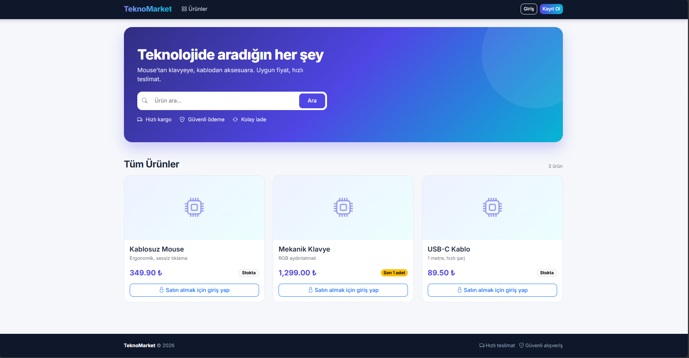
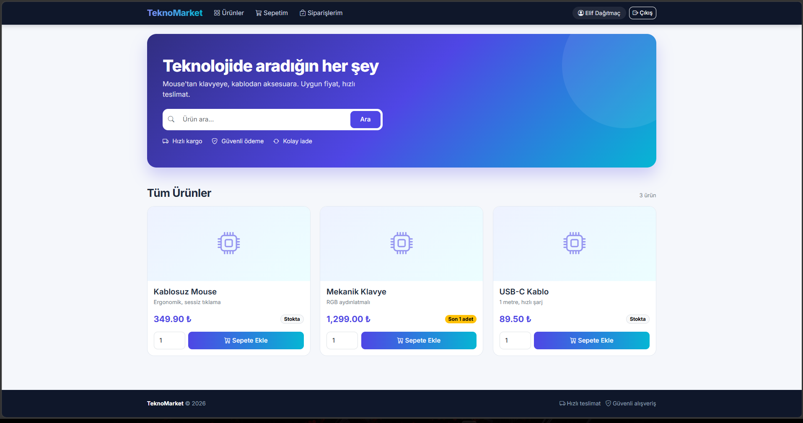
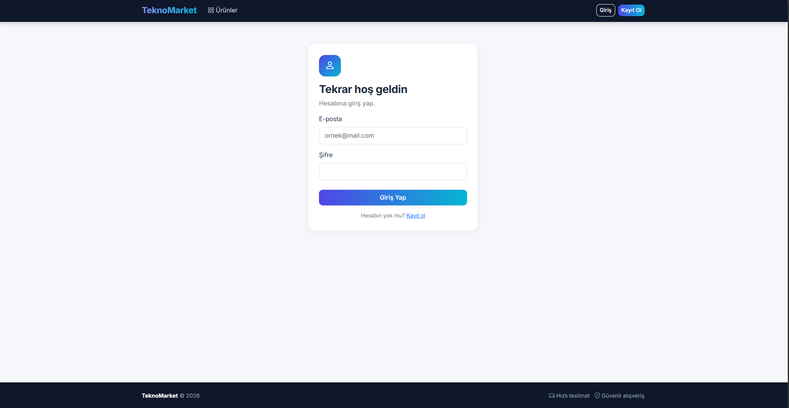
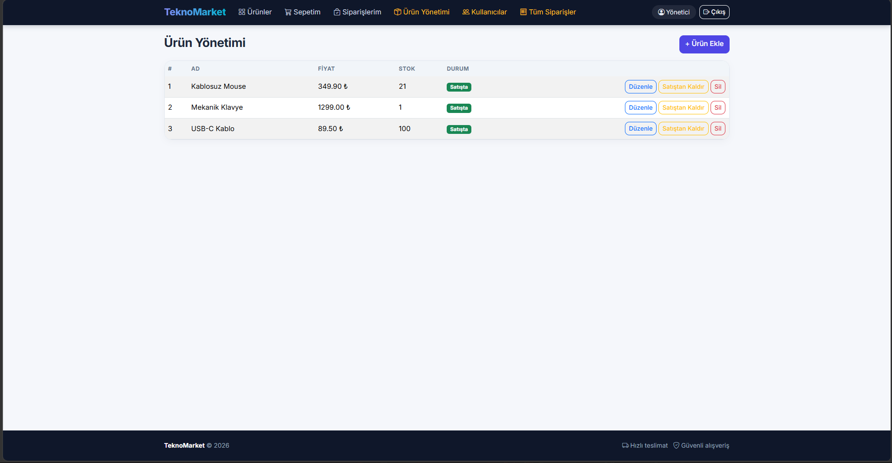
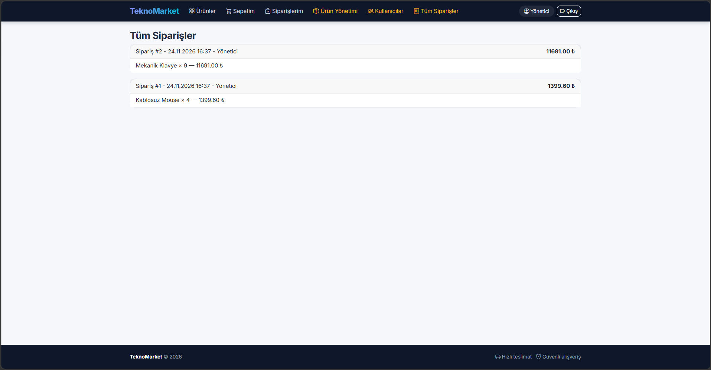

# TeknoMarket – ASP.NET Core E-Ticaret Sitesi

ASP.NET Core MVC ve SQLite ile yapılmış, tam çalışan bir internet alışveriş sitesi.
Piri Reis Üniversitesi **İnternet Programcılığı (BIP 2035)** dersi dönem projesidir.



## Özellikler

Sitede üç tür kullanıcı vardır:

| Rol | Neler yapabilir? |
|---|---|
| **Ziyaretçi** (giriş yapmamış) | Ürünleri gezer ve arar. Satın alamaz. |
| **Kullanıcı** | Kayıt olur, admin onayından sonra giriş yapar. Ürün ve adet seçer, sepete ekler, satın alır, siparişlerini görür. |
| **Admin** | Ürün ekler, siler, fiyat ve stok günceller, ürünü satıştan kaldırır. Kullanıcıları onaylar ve yetkilendirir. Tüm siparişleri görür. |

Diğer özellikler:
- Satın almada stok kontrolü; sipariş sonrası stok otomatik düşer
- Şifreler veritabanında şifrelenmiş (hash) olarak saklanır
- Çerez (cookie) tabanlı giriş ve rol bazlı yetkilendirme
- Formlarda CSRF koruması
- Telefonda da düzgün görünen tasarım (Bootstrap 5)

## Kullanılan Teknolojiler

- C# / ASP.NET Core MVC (.NET 10)
- Entity Framework Core + SQLite
- Razor sayfaları, HTML, CSS, Bootstrap 5, Bootstrap Icons

## Çalıştırma

Gerekenler: [.NET 10 SDK](https://dotnet.microsoft.com/download)

```bash
git clone https://github.com/elifdagitmac/EticaretSitesi.git
cd EticaretSitesi
dotnet run
```

Terminalde yazan adresi (örn. `http://localhost:5000`) tarayıcıda açın.
Visual Studio ile açmak için `EticaretSitesi.csproj` dosyasını açıp **Ctrl+F5** yapmanız yeterli.

Veritabanı (`eticaret.db`) ilk çalıştırmada otomatik oluşur ve içine örnek ürünler eklenir.

**Varsayılan admin hesabı:**

| E-posta | Şifre |
|---|---|
| `admin@site.com` | `Admin123!` |

## Proje Yapısı

```
EticaretSitesi/
├── Program.cs              # Başlangıç: servisler, veritabanı, giriş ayarları
├── Data/AppDbContext.cs    # Veritabanı ve tablolar
├── Models/                 # Kullanici, Urun, SepetOgesi, Siparis
├── Controllers/            # Home, Account, Sepet, Siparis, Admin
├── Views/                  # Razor sayfaları
└── wwwroot/css/site.css    # Tasarım
```

## Veritabanı

| Tablo | İçerik |
|---|---|
| Kullanicilar | Ad soyad, e-posta, şifre (hash), rol, onay durumu |
| Urunler | Ad, açıklama, fiyat, stok, satışta mı, resim adresi |
| SepetOgeleri | Kullanıcının sepetindeki ürünler ve adetleri |
| Siparisler | Sipariş tarihi, kullanıcı ve toplam tutar |
| SiparisKalemleri | Siparişteki ürünler, o anki fiyatları ve adetleri |

## Ekran Görüntüleri

| Kullanıcı ana sayfası | Giriş |
|---|---|
|  |  |

| Admin – Ürün Yönetimi | Admin – Tüm Siparişler |
|---|---|
|  |  |

## Geliştirenler

- Elif Nur Dağıtmaç
- Çınar Ali Kaya
